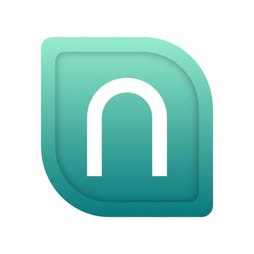

# ioBroker.nuasense

**Tests:** 

## NuaSense adapter for ioBroker

What your weather station means for your house and garden, as ioBroker states — and, if you like, your station forwarded from ioBroker to NuaSense. The first three stations on a NuaSense account connect free.

### Read

Make an API key in the NuaSense console under **API Keys** (scope `ingest:write`; it is what reads your own stations), put it into the adapter, and tell it what the garden mostly is (lawn, vegetables, flower beds and shrubs) and your sprinkler's rate in mm per hour (pop-up sprinkler about 10, drip line 2–4; 0 for millimetres only). Every 15 minutes (configurable) the adapter writes, per station:

| state | meaning |
|---|---|
| `tonight.low`, `tonight.at`, `tonight.frost`, `tonight.grassLow` | the coming night: low in °C, when, `none` / `watch` (grass level may freeze: pots in) / `frost`, grass-level estimate |
| `garden.wateringMm`, `garden.wateringMinutes` | what the garden needs today — evaporation minus the rain of the last 24 h and the rain forecast for the next 24 h; `0` means skip. Minutes at your sprinkler's rate, ready for a script that opens a valve once a day |
| `garden.rainNext24h`, `garden.rainLast24h`, `garden.et0`, `garden.et0Source` | the figures behind it; ET0 comes from your own station once it has a day of data, from the forecast before |
| `plausibility.verdict`, `.reading`, `.model`, `.difference` | your latest reading against the forecast model for that hour: `plausible`, or `implausible` when they differ by more than 5 °C (a wrong unit, a sensor indoors) — no cause is guessed |
| `lastUpload`, `device` | when the station last sent, and from what |

**Advanced** (a checkbox) adds the agronomy values for farms, vineyards and nurseries: `spray.*` (next calm dry window) and `hourly.*` (ET0 per hour, leaf-wetness hours, spray quality, VPD, delta T, hourly means).

`info.connection` says whether NuaSense answered with this key.

### Send

Any weather station ioBroker already has — through the Ecowitt, Sainlogic, Bresser, Netatmo or MQTT adapters, or rtl_433 — can become a NuaSense station:

1. In the NuaSense console: **External stations → Add a station**, pick *Home Assistant / weewx / Meteobridge / Node-RED*, give it a name and a position. The last screen shows a path like `/station/kw7n-4hpd-x2vt`; the part after `/station/` is the token.
2. In the adapter's *Forward a station* tab: switch forwarding on, paste the token, and pick the states that hold temperature (°C), humidity (%), pressure at station level (hPa), wind (m/s or km/h), gusts, direction, the rain total (mm, a counter that only grows) and solar radiation or light.
3. The adapter sends once a minute, exactly as an Ecowitt console would. `forward.lastStatus` shows the receiver's answer; the console shows the first upload within a minute.

Missing values are simply not sent. The station's path is bound to the first device id that uses it, so keep the device id stable.

### Your data

When you connect a station, NuaSense stores its readings and computes your forecast, spray windows and risks from them. The readings are used aggregated and anonymised to improve forecasts and models for everyone; they are never passed on individually without your opt-in. You can disconnect the station in the console at any time and have all its data deleted.

## Changelog
<!--
    Placeholder for the next version (at the beginning of the line):
    ### **WORK IN PROGRESS**
-->
### 0.2.0 (2026-11-05)
* (NuaSense) house & garden first: frost tonight, watering today in mm and minutes, rain next 24 h, plausibility; agronomy values behind Advanced

### 0.1.1 (2026-11-03)
* (NuaSense) checker fixes: Node.js 22, i18n for the admin UI, responsive sizes, trusted-publishing workflow, node:crypto

### 0.1.0 (2026-11-03)
* (NuaSense) first release: first look and hourly agronomy as states; optional forwarding of a station from ioBroker to NuaSense

## License
MIT License

Copyright (c) 2026 NuaSense <manuel@nuasense.com>

Permission is hereby granted, free of charge, to any person obtaining a copy
of this software and associated documentation files (the "Software"), to deal
in the Software without restriction, including without limitation the rights
to use, copy, modify, merge, publish, distribute, sublicense, and/or sell
copies of the Software, and to permit persons to whom the Software is
furnished to do so, subject to the following conditions:

The above copyright notice and this permission notice shall be included in all
copies or substantial portions of the Software.

THE SOFTWARE IS PROVIDED "AS IS", WITHOUT WARRANTY OF ANY KIND, EXPRESS OR
IMPLIED, INCLUDING BUT NOT LIMITED TO THE WARRANTIES OF MERCHANTABILITY,
FITNESS FOR A PARTICULAR PURPOSE AND NONINFRINGEMENT. IN NO EVENT SHALL THE
AUTHORS OR COPYRIGHT HOLDERS BE LIABLE FOR ANY CLAIM, DAMAGES OR OTHER
LIABILITY, WHETHER IN AN ACTION OF CONTRACT, TORT OR OTHERWISE, ARISING FROM,
OUT OF OR IN CONNECTION WITH THE SOFTWARE OR THE USE OR OTHER DEALINGS IN THE
SOFTWARE.
